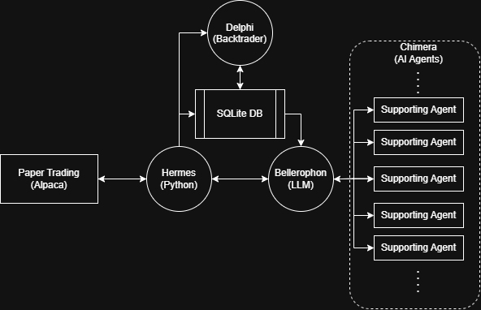

# Aspen: A Trading Bot

Aspen is a paper trading automation that makes use of AI analysis of stock prices and current news.

## Architecture

Aspen is implemented in Python, and is laid out as follows:

